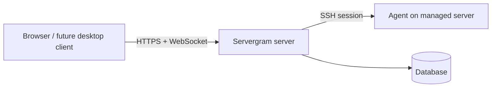

> **⚠️ Disclaimer:** Servergram is currently under active development. Features may be added, removed, or changed without notice. The documentation may not reflect the current state of the codebase.

Servergram is a self-hosted web app for managing remote Linux servers. You run one server binary, open the web UI in a browser, and manage your machines over SSH. There is no agent to install by hand and no extra port to expose on the managed server.

## What you can do

- Manage servers, SSH keys, and groups from one dashboard.
- Browse, upload, rename, and delete files.
- Inspect running processes and send stop or signal requests.
- Monitor CPU, memory, disk, network, and top processes in real time.
- Create, edit, run, and monitor cron jobs.
- Review activity logs and notifications.

<Note>
  Docker management and a desktop GUI client are planned but not available yet.
</Note>

## How it works

Servergram has three main parts, plus a planned desktop client:

| Part                | Runs on                       | Role                                                                                             |
| ------------------- | ----------------------------- | ------------------------------------------------------------------------------------------------ |
| **Server**          | Your machine or a host you control | Serves the web UI and API over HTTPS, stores data, and opens SSH connections to managed servers. |
| **Agent**           | Each managed Linux server     | Performs the actual work: files, processes, resources, and cron jobs.                            |
| **Web client**      | Your browser                  | The SvelteKit UI served by the server.                                                            |
| **Desktop client**  | Your desktop                  | Planned GUI client. Use the web UI for now.                                                      |

The flow for a managed server is:

1. You add the server and an SSH private key in the UI.
2. The server connects over SSH and detects the remote OS and architecture.
3. It uploads the matching agent binary to `~/.servergram/agent` on the managed server. The upload is skipped when the remote checksum already matches.
4. It starts `agent serve` inside the SSH session. The agent exposes gRPC over the session's standard input and output, so the SSH connection is the transport and no inbound port is opened.
5. The UI talks to the server over HTTPS, using a WebSocket for live updates and server-sent events for process streams. The server translates those requests into gRPC calls to the agent.

The server is built as a single binary: the web client is embedded from `server/dist` and the Linux agents are embedded from `server/agents`. The agent keeps its own small SQLite database at `~/.servergram/servergram.db` on the managed server.

<Note>
  Managed servers must run Linux on `amd64` or `arm64` and must allow SSH access for the user whose key you provide.
</Note>

## Next steps

<CardGroup cols={2}>
  <Card title="Installation" icon="download" href="/installation">
    Download the server binary or build everything from source.
  </Card>
  <Card title="Configuration" icon="gear" href="/config">
    Environment variables for the server.
  </Card>
  <Card title="Using Servergram" icon="server" href="/usage/servers">
    Add servers and keys, browse files, monitor processes, and manage cron jobs.
  </Card>
  <Card title="API and protocol" icon="code" href="/reference/api">
    REST endpoints, server-sent events, and the WebSocket protocol.
  </Card>
</CardGroup>
