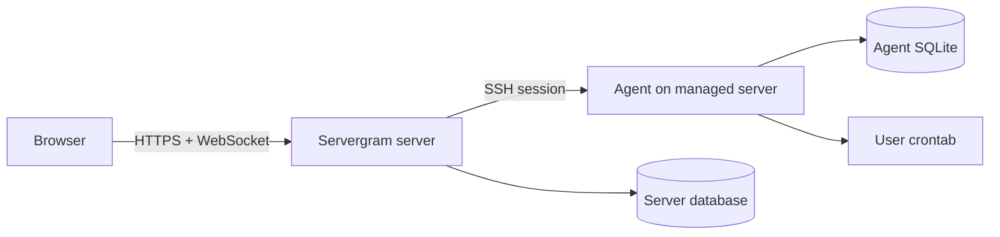

Servergram has three parts: the server, the agent, and the web client. The server is the only component you expose to the network. The agent runs on each managed server and communicates inside an SSH session.

## Components

| Component | Runs on | Role |
| --- | --- | --- |
| **Server** | Your machine or a host you control | Serves the web UI and API over HTTPS, stores data, and manages SSH connections. |
| **Agent** | Each managed Linux server | Performs file, process, resource, and cron operations. |
| **Web client** | Your browser | The SvelteKit UI served by the server. |

The server is a single Go binary. The web client is embedded from `server/dist`, and the Linux agents are embedded from `server/agents`.

## Connection lifecycle

When you connect to a server, the server:

1. Loads the server record and its SSH key.
2. Decrypts the private key with `SHH_MASTER_KEY`.
3. Opens a TCP connection to the configured host and port, with a 30-second dial timeout.
4. Verifies the host key against the stored SHA-256 fingerprint.
5. Runs `uname -s` and `uname -m` to detect the operating system and architecture.
6. Selects the matching embedded agent binary. Only Linux on `amd64` and `arm64` is supported.
7. Reads the remote home directory and computes the SHA-256 of the local agent.
8. Uploads the agent to `~/.servergram/agent` if the remote checksum differs. The upload has a 200-second timeout, writes to a temporary file, sets mode `700`, and renames it into place.
9. Starts `agent serve` inside a new SSH session.
10. Speaks gRPC with the agent over that session's standard input and output.

The SSH connection is the transport. The agent does not open a TCP port, and the managed server needs no inbound firewall rule for Servergram.

The server sends SSH keepalives and gRPC keepalives every 15 seconds. If the agent exits or the session drops, the server marks the server disconnected.

## Host key verification

Servergram pins the SSH host key:

- On the first connection, the server records the SHA-256 fingerprint and marks the server untrusted. The UI asks you to verify and trust it.
- On later connections, the server compares the presented key with the stored fingerprint.
- A mismatch is reported to the UI with both fingerprints. It is not accepted automatically.

This is trust on first use with an explicit manual step. Verify fingerprints out of band, especially after a rebuild or IP reuse.

## Authentication and sessions

Authentication is optional and instance-wide:

- `PASSWORD` enables a single password for the web UI, API, and WebSocket.
- If `PASSWORD` is empty, authentication is disabled.
- The password is compared in constant time using SHA-256 digests.
- A successful sign-in creates a 32-byte random token. The raw token goes in the `session_token` cookie; the database stores only its SHA-256 hash.
- The cookie is `HttpOnly`, `Secure`, and `SameSite=Lax`.
- Sessions expire after `SESSION_TTL` days. Expired sessions are rejected and cleaned up on sign-in.

There are no users, roles, or per-server permissions. Anyone who can sign in can manage every server and view every key.

## Secrets at rest

SSH private keys are encrypted before they are stored:

- Key derivation: Argon2id with a random 16-byte salt.
- Encryption: AES-256-GCM with a random nonce.
- The derived key comes from `SHH_MASTER_KEY`.
- The stored value uses a versioned `v1:` prefix.

`SHH_MASTER_KEY` is required, must meet the password rules, and must differ from `PASSWORD`. Changing it makes existing encrypted keys unreadable.

<Warning>
  Back up `SHH_MASTER_KEY` separately from the database. Without it, saved SSH keys cannot be decrypted.
</Warning>

## Transport security

- The server serves HTTPS only, with TLS 1.2 or newer.
- The server refuses to start if the certificate or key file is missing.
- SSH encrypts and authenticates traffic to managed servers.
- gRPC between the server and agent runs inside the SSH session with insecure transport credentials, because SSH already provides encryption and authentication.
- CORS allows credentials only for exact origins in `ALLOWED_ORIGINS`.
- WebSocket handshakes check the `Origin` header against the same list.

## Data storage

### Server database

The server stores its data in the database configured by `DATABASE_URL`:

| Table | Contents |
| --- | --- |
| `servers` | Server name, host, port, username, group, key, OS, architecture, trust state, fingerprint. |
| `ssh_keys` | Key name, encrypted private key, passphrase flag. |
| `groups` | Group names. |
| `sessions` | Hashed session tokens, OS, user agent, expiry. |
| `logs` | Activity log entries. |
| `notifications` | Notification title, message, URL, read state. |

SQLite is the default. PostgreSQL, MySQL, and SQL Server are also supported. Tables are migrated automatically at startup.

### Agent storage

The agent keeps its own state on the managed server:

| Path | Contents |
| --- | --- |
| `~/.servergram/agent` | The agent binary. |
| `~/.servergram/servergram.db` | Cron jobs and run records in SQLite. |
| `~/.servergram/agent/logs/<job-id>/` | Cron run logs. |

The agent's database is separate from the server's database. It is not backed up or migrated by the server.

## Network ports

| Direction | Port | Purpose |
| --- | --- | --- |
| Inbound to Servergram | `SERVER_PORT` (default `9788`) | HTTPS UI, API, WebSocket, OpenAPI docs. |
| Outbound from Servergram | Managed server's SSH port (default `22`) | SSH session and agent transport. |
| Inbound to managed server | None required | The agent uses the SSH session's stdin/stdout. |

## Platform support

- The server runs wherever the Go binary and its database drivers run.
- Managed servers must run Linux on `amd64` or `arm64`.
- The agent uses Linux-specific features such as `crontab` and `/proc`-based process sampling.
- Docker management and a desktop client are planned but not available.

## Security boundaries and limitations

Servergram is designed for a trusted operator on a trusted network:

- There is one password and no multi-factor authentication.
- There is no login rate limiting or lockout.
- Any signed-in user can view decrypted SSH private keys.
- The agent runs as the SSH user and does not escalate privileges. A compromised Servergram server can do anything that user can do on every managed server.
- The server keeps connection state in memory. Restarting it drops all SSH sessions.
- Activity logs record actions but not which person performed them.

For internet-facing deployments, put Servergram behind a reverse proxy or VPN, restrict access by source address, use a strong unique password, protect the database and `SHH_MASTER_KEY`, and give the SSH user only the permissions it needs.
